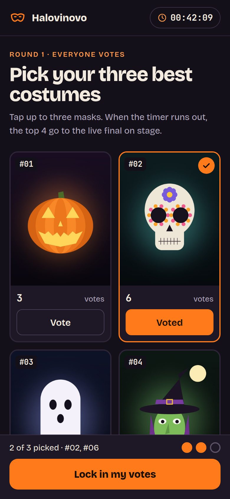
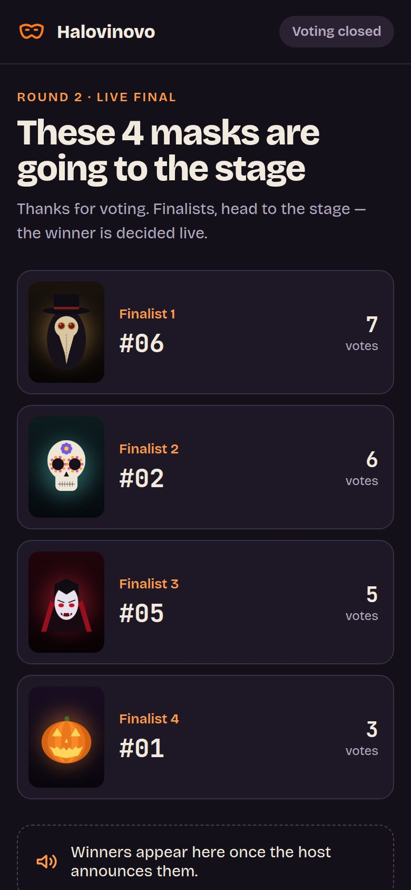
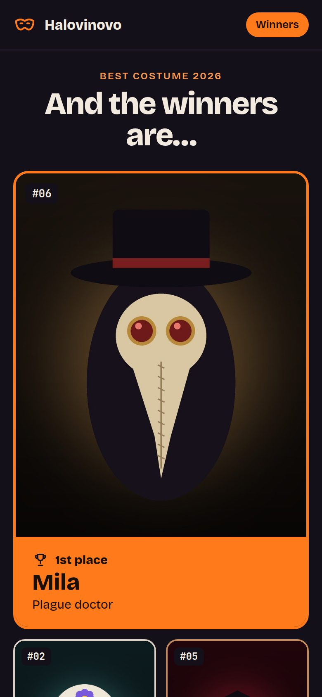
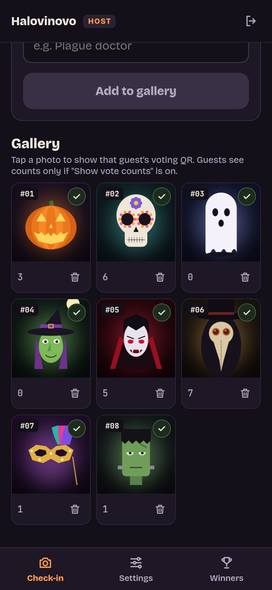
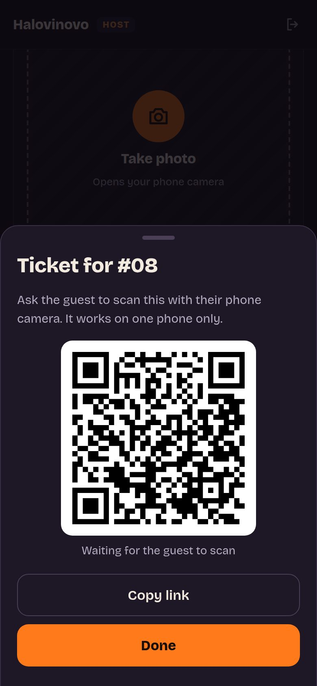
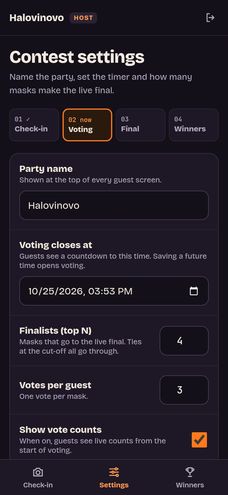
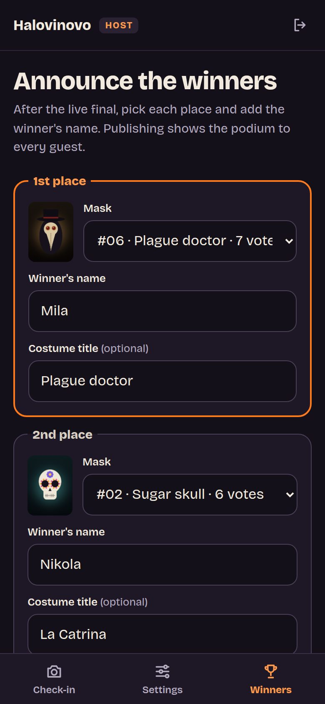

# Halovinovo: Halloween costume vote

Mobile web app for one party: the host photographs each mask on arrival, guests vote from
their phones (no login), the top N go to a live final, and the host publishes the podium.
Behaviour spec and designs are in [specs/](specs/).

Stack: FastAPI + Postgres + nginx (TLS, serves photos) via Docker Compose. Frontend is plain
HTML/CSS/JS in [app/src/static/](app/src/static/).

## Screenshots

Guest screens, which switch by themselves as the party moves on:

| Vote | Finalists | Winners |
|:---:|:---:|:---:|
|  |  |  |

Host screens:

| Check-in gallery | Guest ticket QR | Settings | Announce winners |
|:---:|:---:|:---:|:---:|
|  |  |  |  |

The costume photos are drawn sample images, not real guests.

## Run

```bash
cp .example.env .env      # set ADMIN_USERNAME, ADMIN_PASSWORD, SESSION_SECRET_KEY
docker compose up -d --build
```

- Guests: `https://<host>/`
- Host: `https://<host>/admin`

With `PROD=false` nginx uses a self-signed certificate. For a real domain set `PROD=true` and
replace `example.com` in `nginx/letsencrypt_cert_gen.sh` and `nginx/nginx_letsencrypt.conf`.

Data lives in `./db_persist_data` (Postgres) and `./uploads` (mask photos).

## Running the party

1. **Check-in:** on the Check-in tab, take a photo of each mask and tap *Add to gallery*.
   The guest's voting QR opens right away; they scan it with their phone camera. Tap any
   photo in the gallery to show its QR again later.
2. **Voting:** on Settings, set *Voting closes at* and save. A future close time opens voting.
3. **Final:** voting closes by itself at that time, or tap *End voting now*. Guests see the finalists.
4. **Winners:** after the live final, fill in the Winners tab and *Publish winners*.
5. **Reset tournament** (Settings) wipes everything for the next party.

## Rule decisions

- **Ties at the cut-off:** every mask tied with the Nth place goes through, so there can be more than N finalists.
- **Zero votes** never qualify as a finalist.
- **Unlocked votes count.** *Lock in my votes* only stops a guest changing them.
- **Reopening voting:** saving a future close time during the final phase reopens voting.
- **Podium:** 1st place is required; 2nd and 3rd are optional. Winners can be re-published to fix a typo.
- **One ticket per guest:** every checked-in mask gets a single-use QR ticket. Only the phone
  that claims it can vote, so incognito windows or a second browser can't vote again.
- **Lost phone or cleared browser:** open the guest's QR from the gallery and tap *Issue new
  code*. The old phone stops voting, and the guest's votes and lock carry over to the new one.
- **No self-votes:** a guest can't vote for their own mask.
- **Deleting a mask** also deletes the votes that guest cast.
- **Live updates** use polling every 3 s.
